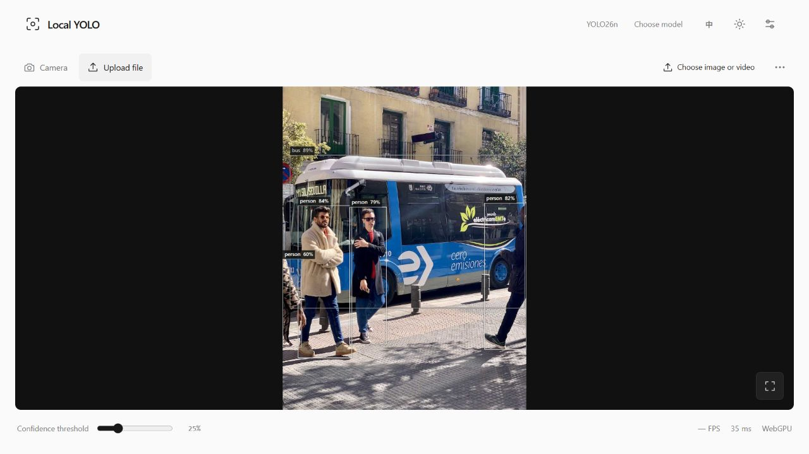
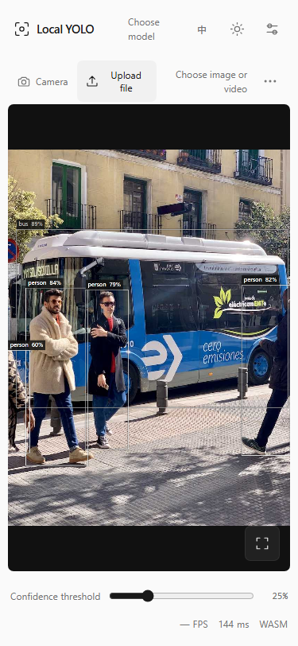
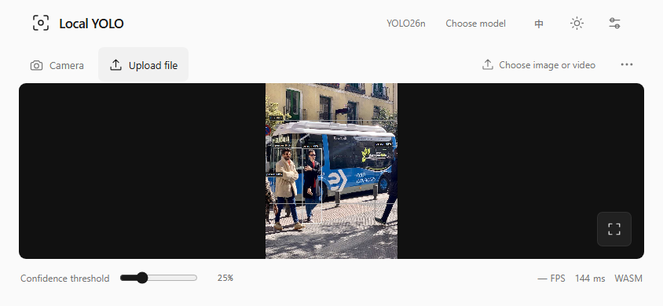
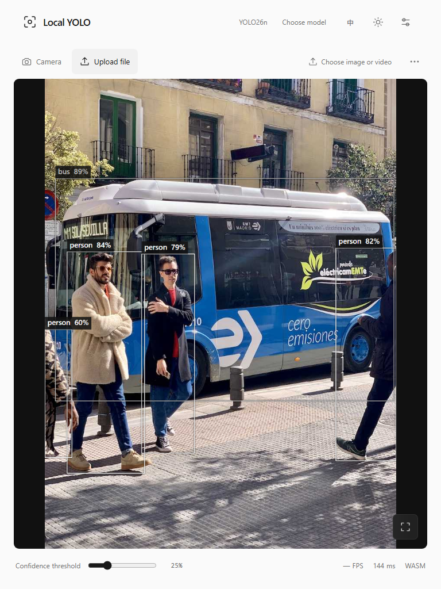
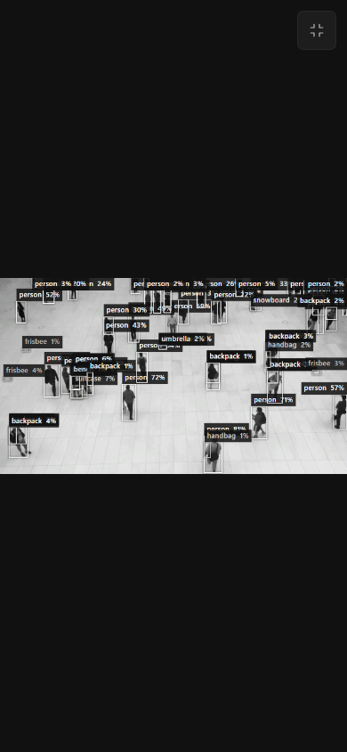

# Minimal V1 → V1.1：界面简化与交互验收

本次验收应用指纹：`3f42cae598f691ad6de779f100a6a69f915baeb3075f3454b897f1a6c2bcdb4c`。对比已读取稳定V1提交`2cea0eb…`的实际HTML与当前实现。第一版本的重点是简化和稳定，不增加Studio/训练产品，也不重做已经完成的黑白风格。

| 区域 | 稳定V1 | 当前V1.1 |
| --- | --- | --- |
| 首页 | 大标题/说明、来源tab、系列/任务/大小多组、装饰卡和详情 | 顶部任务/大小，中央名称/缓存与单启动按钮 |
| 本地模型 | 常驻来源切换 | 底部入口按需展开，保留任务/标签和真实兼容检查 |
| 工作台 | 大标题、多处参数与指标说明 | 预览优先，Confidence和低调实际FPS/延迟/后端 |
| 相机选项 | 设备、镜像、倍率常驻 | 次级菜单保留全部操作 |
| 导出 | 常驻PNG/JSON按钮 | 结果菜单，显示当前文件名 |
| 手机/平板 | 桌面控制密度 | 底部模型菜单、安全区域、动态视口、44px触摸目标 |
| 全屏 | 基础预览操作 | 原生能力/页面回退、独立退出、活动推理时淡出及恢复 |

本轮新增修复集中在交互边界：桌面菜单跳过隐藏关闭控件；ArrowUp/Down正确进入末项/首项；Escape恢复可见焦点；菜单和普通按钮语义一致；文件替换/解码失败后旧导出禁用；忙时阈值应用最新值；鼠标遗留焦点不阻止全屏淡出，键盘焦点仍可见。未改变默认摄像头流程或增加常驻控件。

## 本轮真实验证

应用14项检查全部通过，包括25种选择、真实下载/缓存重载、本地ONNX、真实图片/视频、PNG/JSON、文件清理与摄像头不可用错误。中英、明暗、菜单键盘、忙时阈值及3002×2000坐标回归有独立实际观察，见[browser JSON的checks/uiRun](browser-validation-matrix.json)。

375×650、375×812、390×844、844×390、768×1024、1280×900六视口均无水平/垂直文档溢出，无可见小于44px交互目标，Canvas保持contain。直接点击全屏后工具栏淡出、点击恢复及独立退出已真实通过。以上是Chromium浏览器观察，不能代替iPhone Safari或真实触摸硬件。

## 本轮实际截图

以下均是本轮真实运行保存的截图，对应当前应用。桌面/移动视口图不表示物理手机认证。

[触摸菜单](evidence/current-touch-menu.png)和[触摸全屏](evidence/current-touch-fullscreen.png)来自Chromium真实tap触摸模拟；[4/4原始记录](touch-validation.json)明确标记touchEmulated，不是物理触摸硬件。

## 历史对比与验收判断

原[稳定V1工作台](evidence/v1-workbench.jpg)、[此前V1.1首页](evidence/v1.1-home-light.jpg)和[接手前UI报告](diagnostics/pre-takeover-UI_COMPARISON.md)保留为历史。旧图不用于声明本轮指纹的通过，也不比较不同模型速度/准确率。

简化目标已经落实到实际界面和核心交互；本轮56项回归、25模型三种运行路径、14项应用交互、六视口、4项触摸模拟、PWA11项以及严格本地Gate均通过。首次GitHub CI、应用提交、部署与线上实测状态见[发布收据](DELIVERY.md)；iPhone Safari和物理触摸/摄像头等设备限制仍明确保留。
