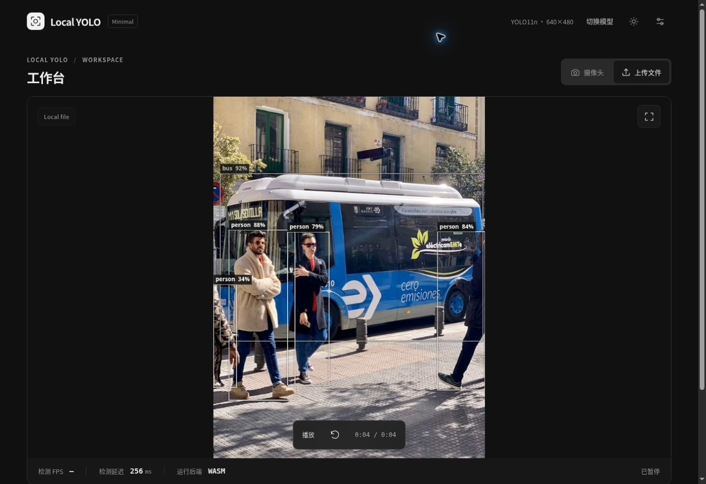
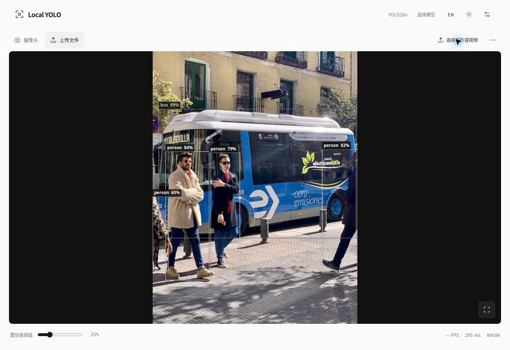
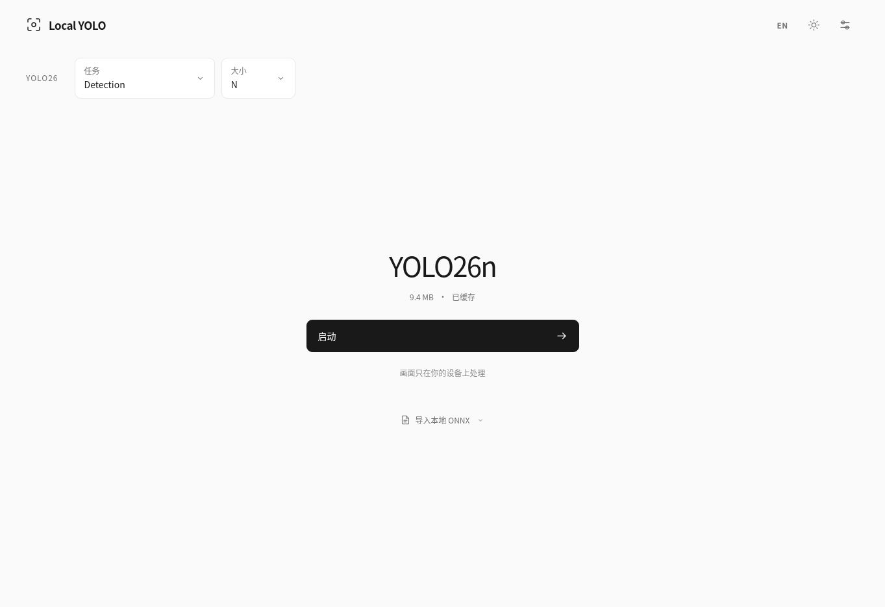
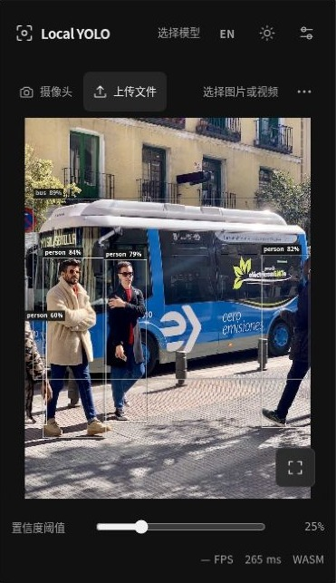

# Minimal V1 → V1.1 界面对比

这些图片是浏览器实际运行页面的截图，含真实推理结果。手机布局使用云端 Chromium iframe 视口，**不是 iPhone Safari 或真机测试**。V1 和 V1.1 的模型不同，不以截图比较模型速度或准确率。

| 区域 | V1 | V1.1 |
| --- | --- | --- |
| 首页 | 模型系列、任务、尺寸及详情占据多个面板 | 固定 YOLO26；顶部任务/尺寸；中央名称、缓存状态和一个启动按钮 |
| 本地模型 | 与在线来源并列 | 底部文字入口，按需展开；保留真实签名与兼容性检查 |
| 工作台 | 设备、参数和性能信息常驻 | 预览优先；设备、镜像、倍率收进次级菜单 |
| 参数 | Confidence、IoU 等 | 仅 Confidence；核心保留 IoU，Minimal 固定 0.45 |
| 性能 | 多处指标和说明 | 低调的实际完成 FPS、完整单次推理延迟及后端 |
| 导出 | 常驻操作 | 次级菜单中的 PNG / JSON |
| 手机 | 桌面式控制密度 | 独立底部模型菜单、44px 触摸区域、安全区域、动态视口 |
| 全屏 | 常规预览控制 | 页面级全屏回退、空闲控制栏淡出、独立且始终可用的退出按钮 |
| 过渡 | 基础状态变化 | 短暂淡入、菜单、按钮反馈、加载状态；尊重减少动画偏好 |

## V1 工作台

保留的原版本真实检测截图，来自本轮修改前的 V1 验证。

## V1.1 工作台

真实 YOLO26 检测；预览按原比例显示，检测框与画面一起缩放。

## V1.1 首页

## V1.1 手机视口

以下为 Chromium 375×650 视口的实际页面截图裁切。原始截图及测量报告保存在 `evidence/phone-375x650-context.jpg`、`evidence/viewport-375x650-workbench.json`；裁切只去掉测试工具的外部界面，没有改动画面或检测结果。另有 375×812、390×844、844×390、768×1024 的实际布局测量。

## 实际修复

- 为预览 Canvas 增加等比例显示，避免纵向媒体在横向容器中拉伸。
- 极小分类图片的文字行高按画布高度调整，避免底部重叠。
- 修正模型返回首页后的旧初始化文案、动态错误的中英文切换及本地模型的来源显示。
- 修复高分辨率图片独立取整后产生的裁切越界；JSON 同时记录实际 `scaleX` / `scaleY`。
- 修复摄像头授权、文件解码和视频播放跨后台或模式切换的异步状态边界。

原生全屏、真实摄像头、iOS 安全区域和主屏幕安装的设备行为仍须真机验证，见 [PWA 验证报告](PWA_VALIDATION.md)。
